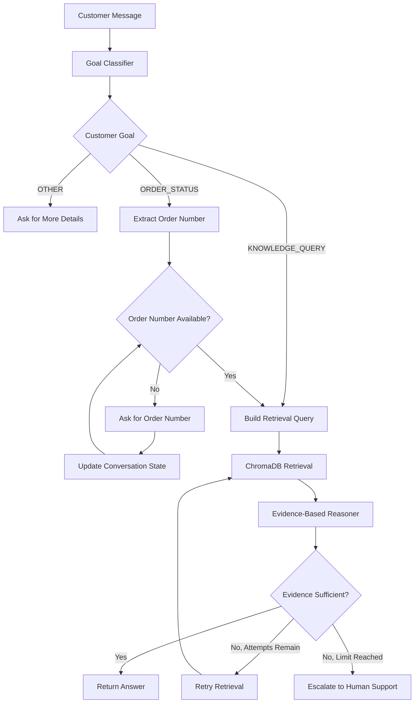

# Customer Support AI Agent

An AI-powered customer support agent built with Python, Ollama, Qwen2.5-3B, ChromaDB, and retrieval-augmented generation (RAG).

The project explores how an AI agent can understand a customer's goal, identify missing information, retrieve relevant knowledge, evaluate supporting evidence, and decide whether to answer, ask a follow-up question, retry retrieval, or escalate to human support.

**Current status:** V1 prototype — core workflow implemented; retrieval quality, safety validation, and end-to-end evaluation are still being improved.

## Table of Contents

- [Overview](#overview)
- [Problem Statement](#problem-statement)
- [Key Features](#key-features)
- [Architecture](#architecture)
- [How the Agent Works](#how-the-agent-works)
- [Technology Stack](#technology-stack)
- [Project Structure](#project-structure)
- [Getting Started](#getting-started)
- [Preparing the Knowledge Base](#preparing-the-knowledge-base)
- [Running the Agent](#running-the-agent)
- [Evaluation](#evaluation)
- [Current Results](#current-results)
- [Limitations and Known Issues](#limitations-and-known-issues)
- [Roadmap](#roadmap)
- [Learning Objectives](#learning-objectives)

## Overview

Traditional chatbots often rely on predefined rules or generate responses without sufficiently verifying the supporting information.

This project takes a different approach: the agent follows a structured workflow and uses retrieved evidence to determine whether it can answer a customer reliably.

For example:

**Customer:** Where is my order?

**Agent:** Could you please provide your order number?

**Customer:** BB123456

The agent maintains the conversation state, extracts the order number, retrieves relevant records, and evaluates whether the available evidence supports an answer.

If the evidence is insufficient, the agent retries retrieval up to a configured limit and then escalates instead of confidently inventing an answer.

## Problem Statement

Customer support systems need to handle different types of requests safely and efficiently:

- Order tracking and delivery status.
- Returns, refunds, shipping, and payment questions.
- Missing customer information.
- Questions that cannot be answered using available evidence.
- Requests that require human support.

The goal is to build an agent that separates goal classification, information collection, retrieval, reasoning, and action selection into distinct stages.

## Key Features

- **Goal classification:** Classifies messages into `ORDER_STATUS`, `KNOWLEDGE_QUERY`, or `OTHER`.
- **Conversation state:** Tracks the customer's goal, order number, and conversation history.
- **Missing-information detection:** Requests an order number when an order-status query does not include one.
- **Retrieval-augmented generation:** Retrieves relevant customer-support knowledge using embeddings and ChromaDB.
- **Evidence-based reasoning:** Evaluates whether retrieved evidence is sufficient to answer the customer's question.
- **Exact order-number filtering:** Filters retrieved order records to avoid relying on evidence for a different order.
- **Bounded retries:** Retries retrieval and reasoning up to three times when evidence is insufficient.
- **Safe escalation:** Escalates when the agent cannot establish a reliable answer.
- **Benchmark evaluation:** Measures goal-classification accuracy and records the agent's actions and evaluation failures.

## Architecture



The diagram represents the intended V1 workflow. Actual behavior should be verified against the current code and evaluation results.

## How the Agent Works

### 1. Goal classification

The router uses Qwen2.5-3B through Ollama to classify the customer's message.

| Goal | Example |
|---|---|
| `ORDER_STATUS` | "Where is my order?" |
| `KNOWLEDGE_QUERY` | "What is your return policy?" |
| `OTHER` | "Hello" |

The classifier returns a structured JSON response containing the goal.

### 2. Conversation state

The `AgentState` object stores:

- The customer's goal.
- The extracted order number, when available.
- The conversation messages collected so far.

This state allows the agent to retain the original order-status goal after asking the customer for their order number.

### 3. Missing-information detection

Before retrieving order information, the agent checks whether the required order number is available.

If it is missing, the agent asks the customer to provide it.

### 4. Knowledge retrieval

The retrieval pipeline uses the `sentence-transformers/all-MiniLM-L6-v2` embedding model to convert queries and knowledge documents into vectors.

ChromaDB stores and searches these vectors to retrieve potentially relevant evidence.

### 5. Evidence-based reasoning

The reasoner receives the customer goal, order number, original question, and retrieved evidence.

It returns a structured decision:

- `SUFFICIENT` — the evidence appears to support an answer.
- `EVIDENCE_INSUFFICIENT` — the evidence is not adequate.
- `CUSTOMER_INFO_MISSING` — required customer information is missing.

The application uses this decision to determine its next action.

**Important safety goal:** A confident answer must not be returned without reliable supporting evidence. Deterministic validation of evidence presence and relevance remains an improvement to verify before considering the safety requirement complete.

### 6. Retry and escalation

The agent allows up to three retrieval attempts when evidence is insufficient.

If it still cannot establish a reliable answer, it escalates to human support rather than inventing an answer.

The retry loop concerns retrieval and reasoning; collecting missing customer information is a separate step.

## Technology Stack

| Component | Technology |
|---|---|
| Programming language | Python |
| Local language model | Qwen2.5-3B |
| Model runtime | Ollama |
| Embeddings | Sentence Transformers |
| Embedding model | `all-MiniLM-L6-v2` |
| Vector database | ChromaDB |
| Data preparation | Pandas and JSON |
| Evaluation | Custom Python evaluation script |
| Version control | Git and GitHub |

## Project Structure

```text
customer-support-agent/
├── app/
│   ├── agent/
│   │   ├── agent.py          # Main agent workflow
│   │   ├── router.py         # Customer goal classification
│   │   ├── reason.py         # Evidence-based reasoning
│   │   ├── state.py          # Conversation state
│   │   └── support_agent.py  # Reserved/unfinished module
│   ├── llm/
│   │   └── client.py         # Reserved/unfinished module
│   ├── rag/
│   │   ├── prepare_data.py   # Prepare knowledge documents
│   │   ├── embed.py          # Generate embeddings
│   │   ├── vectorstore.py    # ChromaDB operations
│   │   ├── retrieve.py       # Retrieve relevant evidence
│   │   └── ingest.py         # Reserved/unfinished module
│   ├── utils/
│   │   └── order_number.py   # Order-number extraction
│   └── main.py
├── data/
│   ├── raw/
│   │   └── customer_support.csv
│   ├── processed/
│   │   ├── knowledge.json
│   │   └── embeddings.json
│   └── chroma/               # Persisted vector database
├── eval/
│   └── v1_eval_50.json       # 50-case evaluation dataset
├── results/
│   └── v1-results.md         # Recorded V1 evaluation
├── tests/
│   └── test_cases.json
├── evaluate_v1.py
├── requirements.txt
├── SPEC.md
└── README.md
```

Some modules listed above are empty or unfinished in the current repository. The main V1 workflow is implemented in `app/agent/agent.py`.

## Getting Started

### Prerequisites

Install the following before running the project:

- Python 3.10 or newer.
- [Ollama](https://ollama.com/).
- Git.

### 1. Clone the repository

```bash
git clone https://github.com/bunnyDasari/customer-support-agent.git
cd customer-support-agent
```

### 2. Create a virtual environment

```bash
python -m venv .venv
```

Activate it on macOS or Linux:

```bash
source .venv/bin/activate
```

On Windows:

```powershell
.venv\Scripts\activate
```

### 3. Install Python dependencies

```bash
pip install -r requirements.txt
pip install pandas sentence-transformers
```

The second command installs dependencies imported by the current data-preparation and embedding code that are not listed in the repository's existing `requirements.txt`.

### 4. Start Ollama and download the model

```bash
ollama pull qwen2.5:3b
```

Make sure the Ollama service is running before starting the agent. Depending on your installation, you can start the Ollama application or run:

```bash
ollama serve
```

If the service is already running, you do not need to start a second instance.

Verify the model is available:

```bash
ollama list
```

## Preparing the Knowledge Base

The repository contains a customer-support dataset and a pipeline for converting its question-and-solution records into searchable embeddings.

Run the following commands from the project root.

### Step 1: Prepare the knowledge documents

```bash
python -m app.rag.prepare_data
```

This reads `data/raw/customer_support.csv` and writes cleaned question-and-solution records to `data/processed/knowledge.json`.

### Step 2: Generate embeddings

```bash
python -m app.rag.embed
```

This converts the prepared knowledge documents into vectors and saves them to `data/processed/embeddings.json`.

### Step 3: Insert embeddings into ChromaDB

```bash
python -m app.rag.vectorstore
```

This inserts the processed documents and embeddings into the local ChromaDB collection.

**Note:** The repository already contains processed data and a persisted ChromaDB directory. If you rebuild the index, use a clean, backed-up development database or otherwise ensure that old records will not conflict with newly inserted IDs. Do not delete the existing database without first confirming that you no longer need it.

## Running the Agent

Start the main conversational agent:

```bash
python -m app.agent.agent
```

Example interaction:

```text
Customer: Where is my order?

Customer Goal: ORDER_STATUS

Agent: Could you please provide your order number?

Customer: BB123456

Current State:
Goal: ORDER_STATUS
Order Number: BB123456
```

The agent then enters its retrieval and reasoning workflow.

The exact response depends on the available records, retrieval results, and model output. The example illustrates the intended interaction, not a guarantee that every order can be resolved.

## Evaluation

The repository includes a 50-case benchmark in `eval/v1_eval_50.json`.

The evaluation script is:

```bash
python evaluate_v1.py
```

It compares predicted customer goals and resulting actions with the expected outcomes in the benchmark. The recorded report is written to:

```text
results/v1-results.md
```

The evaluation covers:

- Order-status requests with and without order numbers.
- General support and policy questions.
- Greetings and other conversational messages.
- The agent's answer, information-request, and escalation behavior.
- Runtime errors during evaluation.

For meaningful comparisons, preserve the same benchmark when comparing V1 with a later version. Keep track of model and prompt changes, and investigate failures rather than reporting only the overall accuracy.

## Current Results

The repository's saved V1 evaluation report records the following baseline:

| Metric | Recorded result |
|---|---:|
| Evaluation cases | 50 |
| Goal classifications correct | 48 / 50 |
| Goal-classification accuracy | 96% |
| Answers | 2 |
| Information requests | 14 |
| Escalations | 18 |
| Runtime errors | 0 |

These figures describe the saved evaluation run, not a fresh run performed by this README.

### What the results tell us

**What is working:**

- The router correctly classifies most examples in the initial benchmark.
- Missing order numbers are detected in order-status scenarios.
- The agent has a defined path for retrieval, reasoning, retries, and escalation.
- The evaluation produces a useful baseline for subsequent improvements.

**What needs improvement:**

- Many knowledge questions escalate instead of producing an answer when one is expected.
- Some edge cases are misclassified.
- Evidence-presence and relevance checks need stronger deterministic enforcement.
- Overall goal accuracy alone does not measure answer correctness, retrieval quality, or safe decision-making.

The next evaluation should measure these behaviors separately rather than treating classification accuracy as the sole measure of success.

## Limitations and Known Issues

This is an evolving prototype, not a production customer-support system.

1. **Retrieval quality:** Relevant knowledge is not always retrieved for general policy questions.
2. **Evidence validation:** The reasoning component defines an evidence-presence helper, but the main reasoning flow does not currently enforce it as a mandatory precondition.
3. **Classifier edge cases:** The goal classifier can misclassify unusual support questions.
4. **Limited conversation interface:** The current workflow uses terminal input and output.
5. **Limited order functionality:** Order-status resolution depends on matching records in the available knowledge source; there is no live order-management integration.
6. **No persistent conversational memory across sessions:** The current `AgentState` is in-memory working state, not a durable long-term memory system.
7. **No production deployment guarantees:** Authentication, privacy controls, observability, load testing, and production-grade escalation integrations still require additional work.

## Roadmap

### V1 — Core agent workflow

- [x] Define the product specification.
- [x] Implement customer goal classification.
- [x] Track basic conversation state.
- [x] Prepare a knowledge base and generate embeddings.
- [x] Integrate ChromaDB retrieval.
- [x] Implement evidence-based reasoning decisions.
- [x] Add bounded retries and escalation.
- [x] Create an initial 50-case benchmark.
- [ ] Improve retrieval quality and evidence validation.
- [ ] Re-run and verify the evaluation after fixes.

### V2 — Better decision-making

- [ ] Separate the customer's underlying goal from the information currently missing.
- [ ] Represent uncertainty explicitly where useful.
- [ ] Compare candidate actions such as answering, asking, retrieving again, and escalating.
- [ ] Estimate the expected value of acquiring additional information.
- [ ] Account for retrieval and model-call costs.
- [ ] Define decision thresholds and evaluate them against a baseline.
- [ ] Add tests for multi-turn conversations and failure cases.

### Future work — Memory and evaluation

- [ ] Introduce a separate memory layer for relevant interaction history.
- [ ] Separate trusted knowledge-base updates from customer-provided claims.
- [ ] Add retrieval-quality and answer-quality metrics.
- [ ] Build regression tests for previously observed failures.
- [ ] Improve logs and reproducibility of evaluation runs.

## Learning Objectives

This project is also a practical learning exercise in AI engineering.

It explores:

- Building structured LLM application workflows.
- Using local language models through Ollama.
- Creating an embedding and vector-search pipeline.
- Designing retrieval-augmented generation systems.
- Maintaining state across multiple conversational turns.
- Separating model-generated decisions from deterministic application logic.
- Handling uncertainty and escalating when evidence is insufficient.
- Evaluating an AI system using a repeatable benchmark.
- Moving from a basic agent toward cost-aware, information-seeking decision-making.

## Contributing and Feedback

Suggestions, issue reports, and discussions about improving retrieval, evaluation, and agent decision-making are welcome.

If you find a failure case, include the customer input, expected behavior, actual behavior, and the relevant evaluation result when possible.

## License

No license is currently specified in this repository. Add a license file before explicitly granting others permission to reuse, modify, or redistribute the project.
